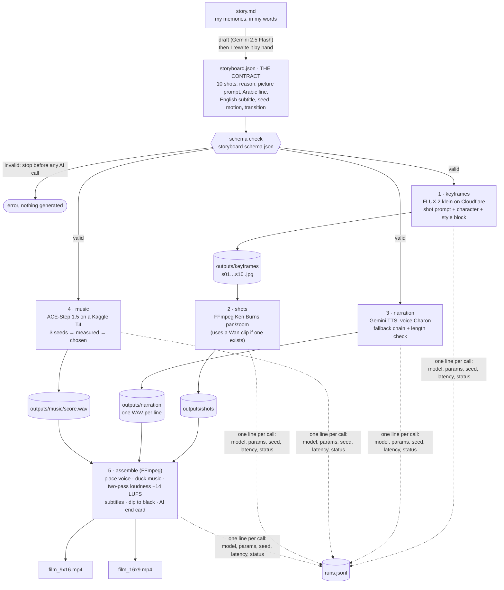
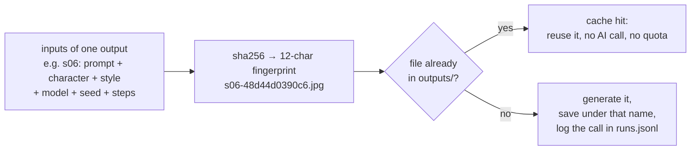
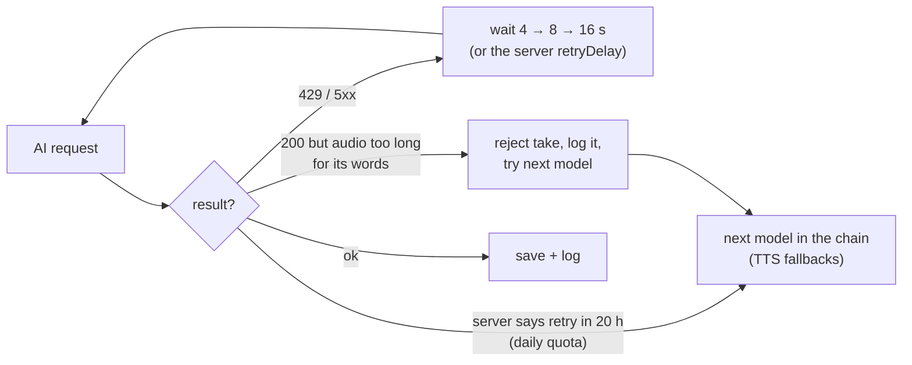

# Youth of the Future / شباب المستقبل

A 78-second AI-made short film about growing up Ethiopian in Riyadh and learning Arabic from the opening songs of
Spacetoon cartoons. Narrated in Arabic, English subtitles, original music. Made by a **pipeline**: one storyboard file
in, the finished film out (9:16 and 16:9), using free AI models only.

> Born in Riyadh in 2001 to an Ethiopian family: Amharic at home, Arabic from the TV. Spacetoon called us
> "the youth of the future". This film is my answer.

**Watch:** [vertical 9:16](https://drive.google.com/file/d/13RIx554GZ6rWLNbxukILUClSHbLYkZYg/view?usp=sharing) ·
[horizontal 16:9](https://drive.google.com/file/d/1Jj3ecnnuerfIo5-OJoSrlDh2KbB8WAuN/view?usp=sharing) ·
[walkthrough (4:49)](https://drive.google.com/file/d/1dUXu--SAWAUdl3R2iIJImSNcsqLi287W/view?usp=sharing) ·
[report](REPORT.md) · [public post (YouTube Short, AI label on)](https://youtube.com/shorts/07Ya2xHqOP0)

## Run it (one command)
```
uv sync
uv run python -m pipeline film          # or: make film
```
Output: `outputs/final/film_9x16.mp4` and `outputs/final/film_16x9.mp4`.
Everything is cached by a hash of its inputs, so a second run makes nothing new; change one shot in `storyboard.json`
and only that shot (picture or voice) is regenerated.

**Tested from a clean clone:** a fresh `git clone` with no `.env` rebuilds the same film in ~47 s with zero model calls,
because every generated image, voice line and the score are committed and named by a hash of their inputs
(EXPERIMENTS.md E11). Keys are only needed to *generate* something new.

First time generating: copy `.env.example` to `.env` and add free keys (step by step in [docs/SETUP.md](docs/SETUP.md)).
Needs Python 3.12 (via [uv](https://docs.astral.sh/uv/)) and FFmpeg. The music is made once on a free Kaggle GPU:
[kaggle.com/code/nebilelias/heritage-short-acestep](https://www.kaggle.com/code/nebilelias/heritage-short-acestep)
(source: [kaggle/acestep_score.ipynb](kaggle/acestep_score.ipynb)).

| Command | What it does |
|---|---|
| `python -m pipeline smoke` | one call per provider, to check keys |
| `python -m pipeline validate` | check `storyboard.json` against the schema |
| `python -m pipeline draft` | Gemini drafts a storyboard from `story.md` (I edit it by hand) |
| `python -m pipeline narration` / `keyframes` | one stage only (cached) |
| `python -m pipeline radio` | voice + music over black: the cheap first prototype |
| `python -m pipeline music import <zip>` / `music choose seed11` | bring in the Kaggle score candidates |
| `python -m pipeline film` | everything |
| `python -m pipeline costs` | per-stage time and cost from `runs.jsonl` |

## What it costs
**$0.** Free tiers only: Gemini (storyboard draft + Arabic TTS), Cloudflare Workers AI (FLUX.2 klein images),
Kaggle T4 GPU (ACE-Step 1.5 music, ~26 s of generation). The real limit is quota, not money: the free TTS allows
~10 requests per model per day, which shaped the design. Measured numbers in [COSTS.md](COSTS.md).

## How it works

### 1. One contract, five stages


### 2. How the cache decides what to regenerate
Every output file is named after a **fingerprint (hash) of everything that made it**. Change one word in one shot,
and only that shot's fingerprint changes, so only that shot is made again.


### 3. When a model fails

Details: [ARCHITECTURE.md](ARCHITECTURE.md).

## The notes (where the thinking is)
| File | What's in it |
|---|---|
| [DESIGN.md](DESIGN.md) | who it's for, the feeling, **two user tests with 3 people each** (verbatim) and what changed |
| [EXPERIMENTS.md](EXPERIMENTS.md) | hypothesis → change → result: image model, TTS model, score choice by measurement, ... |
| [FAILURES.md](FAILURES.md) | 12 real failures: a TTS that invented memories, a 20-hour retry, a WAV inside a WAV, ... |
| [COSTS.md](COSTS.md) | measured time per stage, quotas, GPU time |
| [ETHICS.md](ETHICS.md) | consent, licences, AI labelling, what I chose not to use |

## Repo map
```
storyboard.json        the contract (validated by schema/storyboard.schema.json)
story.md               my notes the storyboard came from
pipeline/              one module per stage + common.py (cache, retries, logging, ffmpeg)
kaggle/                ACE-Step notebook (GPU step)
outputs/               keyframes, narration, music, manifests (films themselves are published, not committed)
runs.jsonl             one line per model call: model, params, seed, latency, status
docs/                  setup guide, narration v2 (waiting for TTS quota)
```

Made with AI: images (FLUX.2 klein), voice (Gemini TTS), music (ACE-Step 1.5). Story, direction, choices and testing: me.
I directed Claude Code as my coding agent.
